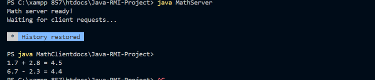
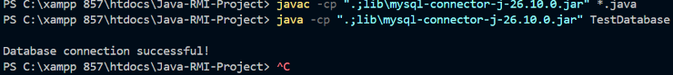
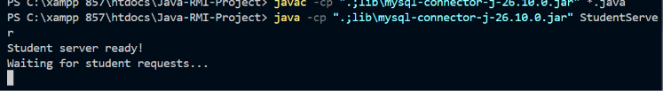
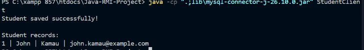
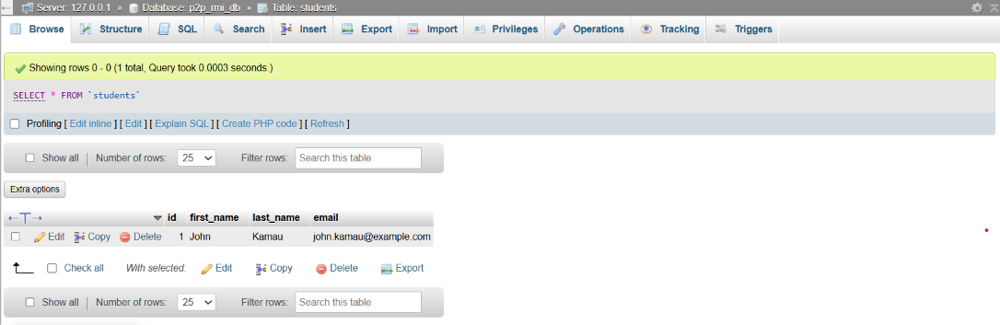

# Java RMI Practical Project – Distributed Systems Module

**Author:** Kosgei Ozni Kimutai

**Institution:** Kabarak University

**Course:** Distributed Systems

**Project:** Java RMI and MySQL Student Record Management

## 1. Project Overview

This project demonstrates Java Remote Method Invocation (RMI), which allows a Java application running on one computer to invoke methods on an object running on another computer.

The project contains two demonstrations:

1. **Remote Mathematics Service:** A client connects to a Java RMI server and remotely performs addition and subtraction.
2. **Student Record Management:** A Java RMI client communicates with a remote student service. The service connects to a MySQL database to save and retrieve student records.

The student management demonstration integrates the communication layer (Java RMI), application layer (Java classes and services), and database layer (MySQL).

**Note:** The implementation uses a client-server RMI architecture. It demonstrates remote communication and database integration, rather than a fully decentralized peer-to-peer network.

## 2. Technologies Used

- Java (JDK 21)
- Java Remote Method Invocation (RMI)
- MySQL
- XAMPP and phpMyAdmin
- MySQL Connector/J 26.10.0
- Visual Studio Code

## 3. Project Structure

The project contains the following main files:

| File                      | Purpose                                          |
| ------------------------- | ------------------------------------------------ |
| `IRemoteMath.java`        | Defines remote addition and subtraction methods  |
| `RemoteMathServant.java`  | Implements the remote mathematics methods        |
| `MathServer.java`         | Starts and registers the mathematics RMI service |
| `MathClient.java`         | Calls the remote mathematics methods             |
| `DatabaseConnection.java` | Establishes a connection to MySQL                |
| `TestDatabase.java`       | Tests the database connection                    |
| `Student.java`            | Represents a student record                      |
| `StudentDAO.java`         | Handles saving student records                   |
| `IStudentService.java`    | Defines the remote student service methods       |
| `StudentService.java`     | Implements the remote student service            |
| `StudentServer.java`      | Starts and registers the student RMI service     |
| `StudentClient.java`      | Sends and retrieves student records through RMI  |

## 4. Database Setup

1. Start Apache and MySQL from the XAMPP Control Panel.
2. Open phpMyAdmin at `http://localhost/phpmyadmin`.
3. Create a database named `p2p_rmi_db`.
4. Select the database and run the following SQL:

```sql
CREATE TABLE students (
    id INT AUTO_INCREMENT PRIMARY KEY,
    first_name VARCHAR(100),
    last_name VARCHAR(100),
    email VARCHAR(150)
);
```

The application uses the following database configuration in `DatabaseConnection.java`:

- Database: `p2p_rmi_db`
- Host: `localhost`
- Port: `3306`
- Username: `root`
- Password: empty by default

If your MySQL account has a password, update the `PASSWORD` value in `DatabaseConnection.java`.

## 5. How to Compile and Run

Ensure Java JDK 21 and MySQL are installed. Also ensure the MySQL Connector/J JAR file is available inside the project's `lib` folder.

Open the project folder in Visual Studio Code and open a terminal in the project directory.

### Step 1: Compile the Java files

```powershell
javac -cp ".;lib\mysql-connector-j-26.10.0.jar" *.java
```

### Step 2: Start the student RMI server

```powershell
java -cp ".;lib\mysql-connector-j-26.10.0.jar" StudentServer
```

The server should display:

```text
Student server ready!
Waiting for student requests...
```

Keep this terminal running.

### Step 3: Run the student client

Open a second terminal in the same project directory and execute:

```powershell
java -cp ".;lib\mysql-connector-j-26.10.0.jar" StudentClient
```

The client connects to the RMI server, submits a student record, and retrieves the available student records from MySQL.

### Important

Start the RMI server before running the client. The RMI registry uses port `1099`.

The mathematics server also uses port `1099`, so do not run both servers at the same time.

## 6. Testing and Results

The project was tested successfully.

- The mathematics client communicated with the RMI server and performed remote addition and subtraction.
- The Java application successfully connected to the MySQL database.
- The student client sent a student record through the RMI service.
- The record was successfully saved and verified in phpMyAdmin.
- The application retrieved student records from the database through the remote service.

## 7. Conclusion

This practical demonstrates how Java RMI enables communication between distributed Java applications. It also demonstrates how a remote service can interact with a MySQL database to store and retrieve information.

The project provides a practical introduction to remote method invocation, client-server communication, database connectivity, and the integration of application and database layers.

## 8. Screenshots and Practical Evidence

The following screenshots demonstrate the implementation and testing of the project.

### Remote Mathematics Service


### Database Connection Test


### Student RMI Server


### Student RMI Client


### MySQL Student Record

---

**Author:** Ozni Kimutai

**Institution:** Kabarak University
